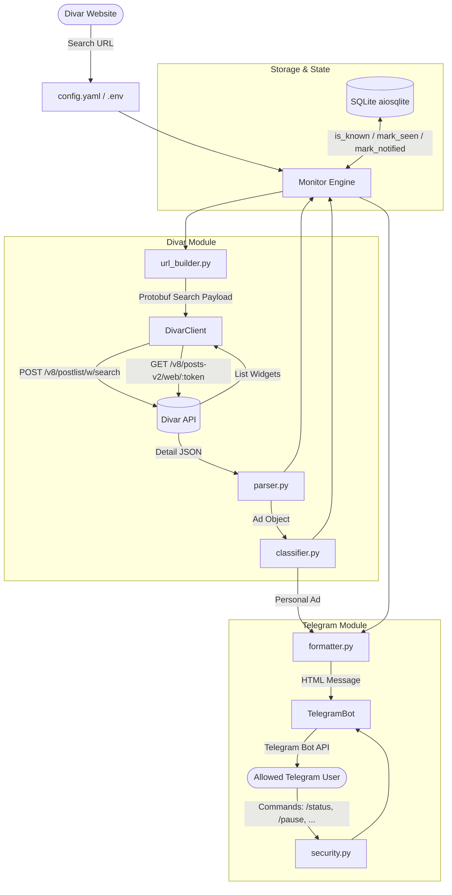
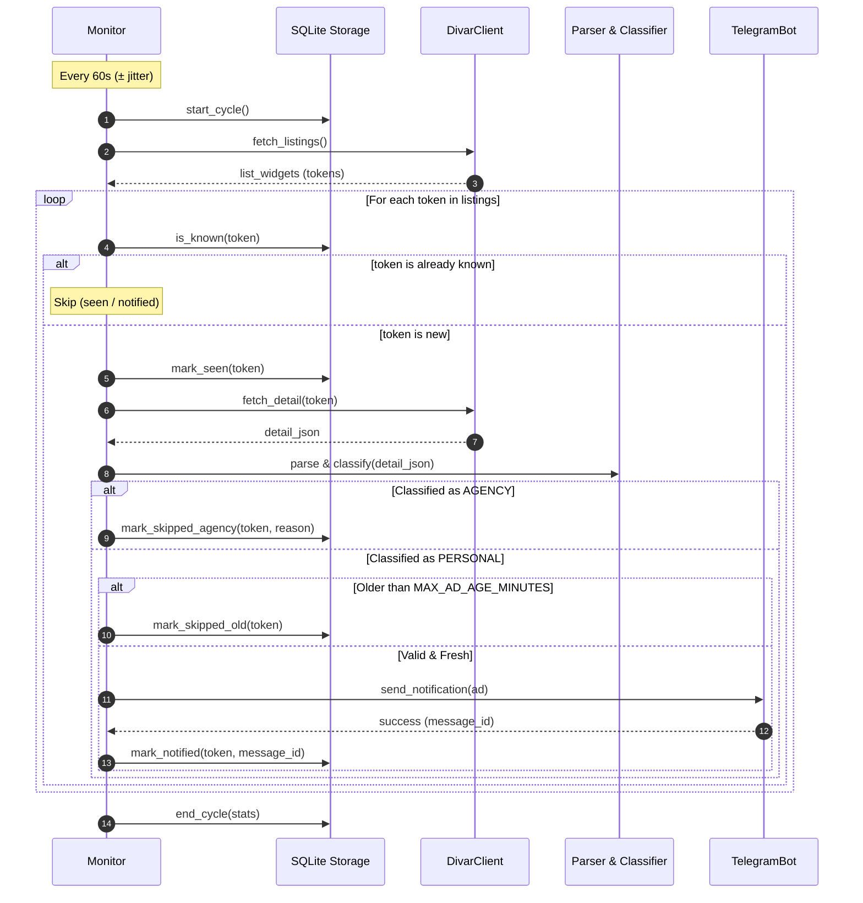

# Architecture & Data Flow (Phase 3)

## 1. System Overview

---

## 2. Monitoring Cycle Sequence

---

## 3. Data Flow & Security
- **Strict Access Control:** Every incoming Telegram update is checked against `ALLOWED_USER_IDS`. Unauthorized users receive zero responses (stealth mode) and are only logged.
- **Fail-safe State Machine:** An ad is only marked `notified` after Telegram confirms HTTP 200 delivery. Failed sends remain pending or are retried next cycle.
- **Circuit Breaker:** If 3 consecutive cycles encounter network/blocking errors, a single health alert is sent to Telegram, suppressing spam until recovered.
